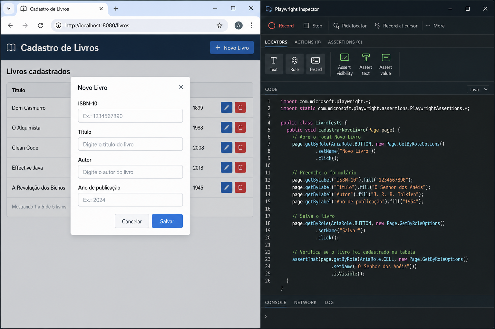

# Playwright

<center>
<iframe src="https://vvs.rpmhub.dev/playwirght/slides/index.html#/"
    title="Playwright" width="90%" height="500" style="border:none;"></iframe>
</center>

## O assistente no navegador

Imagine um assistente sentado no seu lugar, na frente do navegador. Ele abre a página, clica no botão, preenche o formulário e lê o que apareceu na tela. Ele não se cansa. Amanhã ele repete o mesmo roteiro. Se o botão sumiu ou o texto mudou, ele avisa: o teste falhou.
{: .fs-3 }

O [Playwright](https://playwright.dev) é esse assistente. É uma ferramenta da Microsoft para **teste de sistema**: ela dirige o navegador de verdade e percorre a interface como um usuário, de ponta a ponta. Assim como o [Selenium](https://www.selenium.dev), o objetivo é conferir o que a pessoa vê, não só o JSON da API.
{: .fs-3 }

Em outras palavras: o Rest Assured pede o prato na cozinha. O Playwright senta na mesa e come com os olhos. Os dois se complementam. Um confere a API. O outro confere o botão, o campo e a mensagem de sucesso.
{: .fs-3 }

Esta aula usa o cadastro de livros do projeto hexagonal, em `exemplos/hexagonal/frontend`. A interface é uma aplicação Vue servida pelo Quarkus em `http://localhost:8080`. Por ela você cadastra, edita, exclui e lista livros. Os testes Java moram ao lado dos demais testes do módulo, em `src/test/java/dev/ifrs/hexagonal/`.
{: .fs-3 }

> Resumo rápido: se você consegue descrever o teste em voz alta como "abra a home, clique em Novo livro, preencha, salve, então a linha deve aparecer", você já entendeu o Playwright.
{: .fs-3 }

## Por que usar o Playwright?

* **Vários navegadores, uma API.** Chromium (Chrome e Edge), Firefox e WebKit (Safari) entendem as mesmas chamadas.
* **Espera automática.** O assistente só clica quando o botão já está visível e habilitado. Você quase nunca precisa de `Thread.sleep`.
* **Codegen.** Um escriba observa o que você faz na tela e gera o Java.
* **Vídeo e rastreio.** Quando o teste falha, você assiste o filme da falha.
* **Java com JUnit.** Roda no mesmo `./mvnw test` dos outros testes do módulo.
{: .fs-3 }

## O que você precisa ter pronto

* [Java 25](https://openjdk.org), já fixado em `maven.compiler.release` no `pom.xml` do hexagonal.
* [Maven](https://maven.apache.org) 3.9 ou superior. O módulo traz `./mvnw`, então não é obrigatório instalar o Maven na máquina.
* [Docker](https://www.docker.com/) em execução. A anotação `@QuarkusTest` sobe o Quarkus e o MySQL Dev Services sozinha. Para **rodar** os testes, você não precisa iniciar `./mvnw quarkus:dev`. Esse comando só entra na cena quando formos **gravar** com o Codegen.
{: .fs-3 }

O `pom.xml` do módulo já traz Playwright Java, Quarkus JUnit, Rest Assured e o plugin que chama o CLI. Você não adiciona dependência nenhuma para começar.
{: .fs-3 }

Na primeira vez em cada máquina, baixe os binários dos navegadores, na raiz do módulo hexagonal:
{: .fs-3 }

```sh
cd exemplos/hexagonal
./mvnw exec:java -e \
  -D exec.mainClass=com.microsoft.playwright.CLI \
  -D exec.args="install"
```

## A gaveta limpa: anatomia

O assistente é montado em quatro peças, sempre nesta ordem. Vale gravar essa lista de cor.
{: .fs-3 }

| Peça | Analogia | O que faz |
|---|---|---|
| `Playwright` | o motor | Liga o processo interno da ferramenta |
| `Browser` | o navegador | Chromium, Firefox ou WebKit |
| `BrowserContext` | a gaveta limpa | Cookies, armazenamento e sessão só daquele teste |
| `Page` | a aba | Onde o assistente clica, digita e lê |
{: .fs-3 }

A gaveta limpa é a ideia que mais evita surpresa. Cada teste ganha um `BrowserContext` novo. O login, o cookie e o armazenamento do teste anterior não vazam para o próximo. É como esvaziar a gaveta antes de guardar outra coisa.
{: .fs-3 }

Tem um detalhe importante: a gaveta da **sessão** é limpa. O **banco MySQL** não é. Os testes de uma mesma classe compartilham o banco. Por isso, mais adiante, vamos apagar o ISBN de teste pela API antes de cada caso.
{: .fs-3 }

### Espera automática

O assistente não aperta o botão enquanto o botão não está pronto. `click()` espera o elemento visível e habilitado. `assertThat(...).isVisible()` espera o texto aparecer. Essa espera é o oposto de `Thread.sleep`: em vez de adivinhar um tempo, o Playwright observa a tela.
{: .fs-3 }

> Resumo rápido: se o teste "às vezes passa, às vezes falha", desconfie de `Thread.sleep`. A espera automática costuma ser a resposta.
{: .fs-3 }

## O escriba: gravando o primeiro teste

A forma mais rápida de começar é **gravar** a interação, sem escrever código. O **Codegen** abre o navegador, observa o que você faz e gera o Java. Só depois de gravar é que vamos ler o código com calma.
{: .fs-3 }

### Preparando a gravação

O Codegen precisa de uma aplicação no ar. O `@QuarkusTest` só sobe o backend durante os testes. Para esta sessão de gravação, suba o Quarkus na mão:
{: .fs-3 }

```sh
cd exemplos/hexagonal
./mvnw quarkus:dev
```

Com a aplicação em `http://localhost:8080`, abra o Codegen com saída em Java. Use outro terminal, na raiz do módulo hexagonal:
{: .fs-3 }

```sh
cd exemplos/hexagonal
./mvnw exec:java -e \
  -D exec.mainClass=com.microsoft.playwright.CLI \
  -D exec.args="codegen --target java http://localhost:8080"
```

Duas janelas aparecem lado a lado:
{: .fs-3 }

1. O **navegador**, onde você interage normalmente (clica, digita, navega).
2. O **Playwright Inspector**, o painel do escriba, que exibe o código Java em tempo real.
{: .fs-3 }

<center>
  <br/>
  Figura 1. Codegen: navegador (esquerda) e Inspector (direita)
</center>

### O que gravar

Vamos registrar o cadastro de um livro. No navegador, siga estes passos enquanto o Inspector gera o código:
{: .fs-3 }

1. Clique em **Novo livro**.
2. Preencha o ISBN com `156881111X`.
3. Preencha o título com `Erdős on Graphs: His Legacy of Unsolved Problems`.
4. Preencha o autor com `Fan Chung, Ronald L. Graham`.
5. Preencha o ano com `1999`.
6. Clique em **Salvar**.
7. Verifique que a linha com o ISBN aparece na tabela. Use o botão de assertiva do Inspector, descrito logo abaixo.
{: .fs-3 }

Cada clique e cada texto digitado vira uma linha de Java no Inspector.
{: .fs-3 }

### O fluxo da gravação

1. **Inicie.** Assim que o Codegen abre, ele já está gravando (ícone vermelho ativo no Inspector).
2. **Interaja.** Clique em botões, preencha formulários e navegue. Cada ação vira uma linha.
3. **Adicione assertivas.** Use os botões da barra do Inspector.
4. **Pause se precisar.** Clique no botão vermelho para pausar ou retomar.
5. **Copie.** Clique em **Copy** no Inspector. Guarde o resultado. Vamos ler o código na próxima seção.
{: .fs-3 }

### Assertivas durante a gravação

O Inspector tem três botões para criar assertivas sem escrever código:
{: .fs-3 }

| Botão | Método gerado | O que verifica |
|---|---|---|
| Assert visibility | `assertThat(locator).isVisible()` | O elemento está visível na tela |
| Assert text | `assertThat(locator).hasText(...)` | O elemento contém o texto esperado |
| Assert value | `assertThat(locator).hasValue(...)` | Um campo de formulário tem o valor esperado |
{: .fs-3 }

Como usar: clique no botão da assertiva desejada e, em seguida, clique sobre o elemento na página. A linha entra sozinha no código.
{: .fs-3 }

Para o cadastro de livros, use **Assert visibility** sobre a linha da tabela que contém o ISBN `156881111X`.
{: .fs-3 }

### Opções úteis da linha de comando

| Opção | Exemplo | Descrição |
|---|---|---|
| `--browser` | `--browser firefox` | Navegador alvo (chromium, firefox, webkit) |
| `--output` | `--output src/test/java/CadastroLivroGravado.java` | Salva direto em arquivo |
| `--target` | `--target java` | Linguagem de saída |
| `--device` | `--device "iPhone 13"` | Emula um aparelho móvel |
| `--lang` | `--lang "pt-BR"` | Idioma do navegador |
{: .fs-3 }

Para salvar a gravação direto no projeto:
{: .fs-3 }

```sh
cd exemplos/hexagonal
./mvnw exec:java -e \
  -D exec.mainClass=com.microsoft.playwright.CLI \
  -D exec.args="codegen --target java --output src/test/java/dev/ifrs/hexagonal/CadastroLivroGravado.java http://localhost:8080"
```

## Entendendo o código gerado

Depois de gravar, o Inspector exibe um arquivo Java completo. Antes de evoluir para testes mais complexos, vale entender o que cada parte faz.
{: .fs-3 }

O trecho abaixo corresponde ao fluxo gravado: cadastro de um livro e verificação na tabela.
{: .fs-3 }

```java
import com.microsoft.playwright.*;
import com.microsoft.playwright.options.*;
import static com.microsoft.playwright.options.AriaRole.*;
import static com.microsoft.playwright.assertions.PlaywrightAssertions.assertThat;

public class CadastroLivroGravado {
    public static void main(String[] args) {
        try (Playwright playwright = Playwright.create()) {
            Browser browser = playwright.chromium().launch(
                new BrowserType.LaunchOptions().setHeadless(false)
            );
            BrowserContext context = browser.newContext();
            Page page = context.newPage();

            page.navigate("http://localhost:8080");

            page.getByRole(BUTTON, new Page.GetByRoleOptions().setName("Novo livro")).click();
            page.getByRole(TEXTBOX, new Page.GetByRoleOptions().setName("ISBN-")).fill("156881111X");
            page.getByRole(TEXTBOX, new Page.GetByRoleOptions().setName("Título")).fill(
                "Erdős on Graphs: His Legacy of Unsolved Problems"
            );
            page.getByRole(TEXTBOX, new Page.GetByRoleOptions().setName("Autor")).fill(
                "Fan Chung, Ronald L. Graham"
            );
            page.getByRole(SPINBUTTON, new Page.GetByRoleOptions().setName("Ano de publicação"))
                .fill("1999");
            page.getByRole(BUTTON, new Page.GetByRoleOptions().setName("Salvar")).click();

            assertThat(
                page.getByRole(ROW).filter(
                    new Locator.FilterOptions().setHasText("156881111X"))
            ).isVisible();
        }
    }
}
```

Leia como uma frase: *"Abra a home, clique em Novo livro, preencha ISBN, título, autor e ano, clique em Salvar, então a linha com esse ISBN deve estar visível."*
{: .fs-3 }

| Trecho | O que faz |
|---|---|
| `Playwright.create()` | Liga o motor |
| `playwright.chromium().launch(...)` | Abre o Chromium (visível com `setHeadless(false)`) |
| `browser.newContext()` | Abre a gaveta limpa |
| `context.newPage()` | Abre a aba |
| `page.navigate(url)` | Vai até a URL |
| `page.getByRole(...).click()` | Acha o elemento pelo papel ARIA e clica |
| `page.getByRole(...).fill(...)` | Acha o campo e preenche |
| `assertThat(...).isVisible()` | Confere visibilidade, com espera automática |
| `try (Playwright playwright = ...)` | Garante que tudo seja fechado no fim |
{: .fs-3 }

O `try` with resources é o que desliga o motor no final. Sem ele, o processo do Playwright pode ficar órfão na máquina.
{: .fs-3 }

## Seletores que falam a língua da tela

O Codegen prioriza seletores **semânticos**: o que o usuário enxerga, não o CSS escondido no HTML. Isso deixa o teste mais firme quando o layout muda de cor ou de classe, mas o botão continua se chamando **Salvar**.
{: .fs-3 }

| Ordem | Método | Exemplo em Java |
|---|---|---|
| 1ª | `getByRole()` | `page.getByRole(AriaRole.BUTTON, new Page.GetByRoleOptions().setName("Salvar"))` |
| 2ª | `getByText()` | `page.getByText("Nenhum livro cadastrado")` |
| 3ª | `getByLabel()` | `page.getByLabel("Título")` |
| 4ª | `getByPlaceholder()` | `page.getByPlaceholder("Ex.: 1-56881-111-X")` |
| 5ª | `getByTestId()` | `page.getByTestId("btn-salvar")` |
| Último recurso | `locator()` (CSS) | `page.locator("#isbn")` |
{: .fs-3 }

No cadastro de livros, o Codegen escolheu `getByRole` para botões, campos de texto e linhas da tabela porque a interface Vue expõe papéis ARIA nesses elementos. Comece sempre por `getByRole`. Só desça até o CSS se o resto não alcançar o elemento.
{: .fs-3 }

> Resumo rápido: se o teste quebra porque alguém mudou uma classe CSS, o seletor era frágil. Se quebra porque o botão **Salvar** mudou de nome, o seletor estava falando a língua da tela, e a mudança era real.
{: .fs-3 }

## Do main para o JUnit

O Codegen gera um `main()` executável. Para a disciplina, queremos o teste dentro do Maven, com relatório JUnit XML, e com o Quarkus subindo sozinho. Duas anotações substituem a abertura e o fechamento manuais:
{: .fs-3 }

* **`@QuarkusTest`** (de `io.quarkus.test.junit`) sobe o Quarkus e o MySQL Dev Services antes de qualquer teste, na porta configurada por `quarkus.http.test-port=8080`.
* **`@UsePlaywright`** (de `com.microsoft.playwright.junit`) gerencia `Playwright`, `Browser` e `BrowserContext`, e injeta um `Page` novo a cada método `@Test`. Cada teste recebe a gaveta limpa.
{: .fs-3 }

A classe de teste fica reduzida ao essencial:
{: .fs-3 }

```java
package dev.ifrs.hexagonal;

import com.microsoft.playwright.Locator;
import com.microsoft.playwright.Page;
import com.microsoft.playwright.junit.UsePlaywright;
import com.microsoft.playwright.options.AriaRole;
import static com.microsoft.playwright.assertions.PlaywrightAssertions.assertThat;

import io.quarkus.test.junit.QuarkusTest;
import org.junit.jupiter.api.Test;

@QuarkusTest
@UsePlaywright
public class BooksE2ETest {

    @Test
    void cadastraLivro(Page page) {
        page.navigate("http://localhost:8080/");

        page.getByRole(AriaRole.BUTTON,
            new Page.GetByRoleOptions().setName("Novo livro")).click();
        page.getByRole(AriaRole.TEXTBOX,
            new Page.GetByRoleOptions().setName("ISBN-")).fill("156881111X");
        page.getByRole(AriaRole.TEXTBOX,
            new Page.GetByRoleOptions().setName("Título")).fill(
                "Erdős on Graphs: His Legacy of Unsolved Problems");
        page.getByRole(AriaRole.TEXTBOX,
            new Page.GetByRoleOptions().setName("Autor")).fill(
                "Fan Chung, Ronald L. Graham");
        page.getByRole(AriaRole.SPINBUTTON,
            new Page.GetByRoleOptions().setName("Ano de publicação")).fill("1999");
        page.getByRole(AriaRole.BUTTON,
            new Page.GetByRoleOptions().setName("Salvar")).click();

        assertThat(
            page.getByRole(AriaRole.ROW).filter(
                new Locator.FilterOptions().setHasText("156881111X"))
        ).isVisible();
    }
}
```

| Elemento | Função |
|---|---|
| `@QuarkusTest` | Sobe o Quarkus e o MySQL em `http://localhost:8080` |
| `@UsePlaywright` | Liga o assistente, abre o Chromium (invisível) e cria a gaveta por método |
| `Page page` no `@Test` | A aba chega injetada. Você só usa. |
| `@Test` | O JUnit 5 reconhece o método como caso de teste |
{: .fs-3 }

Se quiser **acompanhar com os olhos** (modo visível, útil para depurar na sua máquina), forneça uma `OptionsFactory` em `@UsePlaywright`:
{: .fs-3 }

```java
import com.microsoft.playwright.junit.Options;
import com.microsoft.playwright.junit.OptionsFactory;

@QuarkusTest
@UsePlaywright(BooksE2ETest.HeadedOptions.class)
public class BooksE2ETest {

    public static class HeadedOptions implements OptionsFactory {
        @Override
        public Options getOptions() {
            return new Options().setHeadless(false);
        }
    }

    // ... métodos @Test ...
}
```

`setHeadless(false)` deixa a janela visível. O padrão, sem essa fábrica, é o modo invisível, mais rápido e adequado à integração contínua.
{: .fs-3 }

Execute com `./mvnw test` na raiz do módulo hexagonal. O relatório XML aparece em `target/surefire-reports/`.
{: .fs-3 }

## Cadastro, edição e exclusão

Com `@QuarkusTest` e `@UsePlaywright` em mãos, vamos percorrer as três operações da tela. Cada `@Test` recebe um `Page` novo. Todos compartilham o mesmo banco. Para os testes não dependerem da ordem, apague o ISBN de teste pela API antes de cada caso (404 é ignorado):
{: .fs-3 }

```java
import io.restassured.http.ContentType;
import static io.restassured.RestAssured.given;
import org.junit.jupiter.api.BeforeEach;

@BeforeEach
void limparLivroDeTeste() {
    given().delete("/books/156881111X");
}
```

Para os cenários que precisam de um livro já existente (editar e excluir), o próprio teste cadastra a condição prévia com `POST /books`. É mais rápido e mais firme do que cadastrar pela tela a cada execução.
{: .fs-3 }

### Cadastrar um livro

Os passos abaixo repetem a gravação, com uma verificação extra: a mensagem de sucesso (`role="status"` no `App.vue`).
{: .fs-3 }

Leia em voz alta: *"Dada a home, quando eu criar o livro, então a linha e a mensagem de sucesso aparecem."*
{: .fs-3 }

```java
@Test
void cadastraLivroComMensagemDeSucesso(Page page) {
    page.navigate("http://localhost:8080/");

    page.getByRole(AriaRole.BUTTON,
        new Page.GetByRoleOptions().setName("Novo livro")).click();

    page.getByRole(AriaRole.TEXTBOX,
        new Page.GetByRoleOptions().setName("ISBN-")).fill("156881111X");
    page.getByRole(AriaRole.TEXTBOX,
        new Page.GetByRoleOptions().setName("Título")).fill(
            "Erdős on Graphs: His Legacy of Unsolved Problems");
    page.getByRole(AriaRole.TEXTBOX,
        new Page.GetByRoleOptions().setName("Autor")).fill(
            "Fan Chung, Ronald L. Graham");
    page.getByRole(AriaRole.SPINBUTTON,
        new Page.GetByRoleOptions().setName("Ano de publicação")).fill("1999");

    page.getByRole(AriaRole.BUTTON,
        new Page.GetByRoleOptions().setName("Salvar")).click();

    assertThat(
        page.getByRole(AriaRole.ROW).filter(
            new Locator.FilterOptions().setHasText("156881111X"))
    ).isVisible();

    assertThat(
        page.getByRole(AriaRole.STATUS)
    ).hasText("Livro criado com sucesso.");
}
```

### Editar um livro

O campo ISBN fica desabilitado na edição (`disabled` no `<input>` do `App.vue`). Somente os demais campos podem ser alterados. O teste cria a condição prévia via REST, abre a tela, troca o título e confere a linha nova:
{: .fs-3 }

```java
@Test
void editaLivro(Page page) {
    given()
        .contentType(ContentType.JSON)
        .body("""
            {
              "isbn": "156881111X",
              "title": "Erdős on Graphs: His Legacy of Unsolved Problems",
              "author": "Fan Chung, Ronald L. Graham",
              "publicationYear": 1999,
              "copiesAvailable": 1
            }
            """)
        .post("/books")
        .then().statusCode(201);

    page.navigate("http://localhost:8080/");

    page.getByRole(AriaRole.ROW)
        .filter(new Locator.FilterOptions().setHasText("156881111X"))
        .getByRole(AriaRole.BUTTON,
            new Locator.GetByRoleOptions().setName("Editar"))
        .click();

    Locator campoTitulo = page.getByRole(AriaRole.TEXTBOX,
        new Page.GetByRoleOptions().setName("Título"));
    campoTitulo.clear();
    campoTitulo.fill("Erdős on Graphs (2ª edição)");

    page.getByRole(AriaRole.BUTTON,
        new Page.GetByRoleOptions().setName("Salvar")).click();

    assertThat(
        page.getByRole(AriaRole.ROW)
            .filter(new Locator.FilterOptions()
                .setHasText("Erdős on Graphs (2ª edição)"))
    ).isVisible();
}
```

### Excluir um livro: o diálogo vem primeiro

A exclusão exibe um diálogo nativo do navegador (`window.confirm` em `App.vue`). O Playwright aceita ou recusa esse diálogo. O ponto que mais pega aluno de primeira viagem: o handler precisa ser registrado **antes** do clique. Se você clicar primeiro, o `confirm` aparece sem ninguém escutando, e o teste trava.
{: .fs-3 }

```java
@Test
void excluiLivro(Page page) {
    given()
        .contentType(ContentType.JSON)
        .body("""
            {
              "isbn": "156881111X",
              "title": "Erdős on Graphs: His Legacy of Unsolved Problems",
              "author": "Fan Chung, Ronald L. Graham",
              "publicationYear": 1999,
              "copiesAvailable": 1
            }
            """)
        .post("/books")
        .then().statusCode(201);

    page.navigate("http://localhost:8080/");

    page.onDialog(dialog -> dialog.accept());

    page.getByRole(AriaRole.ROW)
        .filter(new Locator.FilterOptions().setHasText("156881111X"))
        .getByRole(AriaRole.BUTTON,
            new Locator.GetByRoleOptions().setName("Excluir"))
        .click();

    assertThat(
        page.getByRole(AriaRole.ROW)
            .filter(new Locator.FilterOptions().setHasText("156881111X"))
    ).not().isVisible();

    assertThat(
        page.getByRole(AriaRole.STATUS)
    ).hasText("Livro removido com sucesso.");
}
```

`dialog.accept()` confirma. `dialog.dismiss()` recusa, e o livro permanece. Os exercícios 5 e 6 pedem os dois caminhos.
{: .fs-3 }

## Integração com Maven

O Maven Surefire gera relatórios no formato XML do JUnit depois de `mvn test`. Esses arquivos são o padrão que Jenkins, GitHub Actions e GitLab CI sabem importar.
{: .fs-3 }

A classe `BooksE2ETest` entra no ciclo `test` padrão. O `@QuarkusTest` sobe o Quarkus e o MySQL sozinho:
{: .fs-3 }

```sh
cd exemplos/hexagonal
./mvnw test -Dtest=BooksE2ETest
```

Cada classe gera dois arquivos em `target/surefire-reports/`:
{: .fs-3 }

```
target/surefire-reports/
├── BooksE2ETest.txt
└── TEST-BooksE2ETest.xml
```

O XML segue o esquema do JUnit:
{: .fs-3 }

```xml
<?xml version="1.0" encoding="UTF-8"?>
<testsuite name="BooksE2ETest" tests="3" failures="0" errors="0" skipped="0" time="8.42">
  <testcase name="cadastraLivro" classname="dev.ifrs.hexagonal.BooksE2ETest" time="3.15"/>
  <testcase name="editaLivro"    classname="dev.ifrs.hexagonal.BooksE2ETest" time="2.80"/>
  <testcase name="excluiLivro"   classname="dev.ifrs.hexagonal.BooksE2ETest" time="2.47"/>
</testsuite>
```

O projeto hexagonal também tem um perfil `e2e` no `pom.xml`. Atenção: esse perfil executa os testes Playwright em **JavaScript** que vivem em `frontend/e2e/books.spec.js`. Ele **não** roda os testes Java desta aula.
{: .fs-3 }

```sh
cd exemplos/hexagonal
./mvnw test          # roda TODOS os testes Java
./mvnw verify -Pe2e  # testes Java e Playwright em JavaScript do frontend
```

Para executar só os testes de ponta a ponta em Java:
{: .fs-3 }

```sh
./mvnw test -Dtest='Books*E2ETest,BooksMultiBrowserTest,PlayrightTest'
```

## Vários navegadores ao mesmo tempo

O Playwright Java fala com Chromium, Firefox e WebKit com a mesma API. Usando `@ParameterizedTest` do JUnit 5, o mesmo cenário roda nos três. Com `@Execution(ExecutionMode.CONCURRENT)`, os três andam juntos e o tempo total cai.
{: .fs-3 }

### Por que cada invocação cria o seu Playwright

A classe `Playwright` **não pode ser compartilhada entre threads**. Ela guarda processo e estado internos que falham quando duas threads chamam ao mesmo tempo. A abordagem antiga (um `Playwright` estático em `@BeforeAll`) impede o uso de `CONCURRENT`.
{: .fs-3 }

A solução é simples: **cada invocação do teste parametrizado cria e fecha o seu próprio `Playwright`** num `try` with resources. Como cada invocação roda na sua thread, não há estado compartilhado, e o paralelismo funciona com `@QuarkusTest`.
{: .fs-3 }

ISBNs diferentes por navegador evitam briga no banco compartilhado. Chromium, Firefox e WebKit gravam livros distintos.
{: .fs-3 }

A classe `PlayrightTest` combina dois estilos. O método `test` usa a `Page` injetada por `@UsePlaywright` (Chromium com `slowMo` e vídeo). O método `cadastraLivroEmCadaNavegador` cria o próprio `Playwright` por invocação e roda em paralelo:
{: .fs-3 }

```java
package dev.ifrs.hexagonal;

import static com.microsoft.playwright.assertions.PlaywrightAssertions.assertThat;

import com.microsoft.playwright.Browser;
import com.microsoft.playwright.BrowserContext;
import com.microsoft.playwright.BrowserType;
import com.microsoft.playwright.Page;
import com.microsoft.playwright.Playwright;
import com.microsoft.playwright.junit.Options;
import com.microsoft.playwright.junit.OptionsFactory;
import com.microsoft.playwright.junit.UsePlaywright;
import com.microsoft.playwright.options.AriaRole;

import io.quarkus.test.junit.QuarkusTest;

import java.nio.file.Paths;
import java.util.stream.Stream;

import org.junit.jupiter.api.Test;
import org.junit.jupiter.api.parallel.Execution;
import org.junit.jupiter.api.parallel.ExecutionMode;
import org.junit.jupiter.params.ParameterizedTest;
import org.junit.jupiter.params.provider.MethodSource;

@QuarkusTest
@UsePlaywright(PlayrightTest.WithVideo.class)
public class PlayrightTest {

    static Stream<String> navegadores() {
        return Stream.of("chromium", "firefox", "webkit");
    }

    @Test
    void test(Page page) {
        page.navigate("http://localhost:8080/");
        page.getByRole(AriaRole.BUTTON,
                new Page.GetByRoleOptions().setName("Novo livro")).click();
        page.getByRole(AriaRole.TEXTBOX,
                new Page.GetByRoleOptions().setName("ISBN-")).fill("6587958494");
        page.getByRole(AriaRole.TEXTBOX,
                new Page.GetByRoleOptions().setName("Título")).fill("Estatistica Basica");
        page.getByRole(AriaRole.TEXTBOX,
                new Page.GetByRoleOptions().setName("Autor")).fill("Rodrigo");
        page.getByRole(AriaRole.BUTTON,
                new Page.GetByRoleOptions().setName("Salvar")).click();
        assertThat(page.locator("tbody")).containsText("6587958494");
    }

    @ParameterizedTest(name = "cadastraLivro [{0}]")
    @MethodSource("navegadores")
    @Execution(ExecutionMode.CONCURRENT)
    void cadastraLivroEmCadaNavegador(String nomeNavegador) {
        String isbn = switch (nomeNavegador) {
            case "firefox" -> "0201634554";
            case "webkit"  -> "0596007124";
            default        -> "0306406152";
        };

        try (Playwright pw = Playwright.create()) {
            BrowserType tipo = switch (nomeNavegador) {
                case "firefox" -> pw.firefox();
                case "webkit"  -> pw.webkit();
                default        -> pw.chromium();
            };

            try (Browser browser = tipo.launch(
                        new BrowserType.LaunchOptions().setSlowMo(300));
                 BrowserContext context = browser.newContext(
                        new Browser.NewContextOptions()
                                .setRecordVideoDir(
                                        Paths.get("target/videos/" + nomeNavegador)))) {

                Page page = context.newPage();
                page.navigate("http://localhost:8080/");

                page.getByRole(AriaRole.BUTTON,
                        new Page.GetByRoleOptions().setName("Novo livro")).click();
                page.getByRole(AriaRole.TEXTBOX,
                        new Page.GetByRoleOptions().setName("ISBN-")).fill(isbn);
                page.getByRole(AriaRole.TEXTBOX,
                        new Page.GetByRoleOptions().setName("Título")).fill("Estatistica Basica");
                page.getByRole(AriaRole.TEXTBOX,
                        new Page.GetByRoleOptions().setName("Autor")).fill("Rodrigo");
                page.getByRole(AriaRole.BUTTON,
                        new Page.GetByRoleOptions().setName("Salvar")).click();

                assertThat(page.locator("tbody")).containsText(isbn);
            }
        }
    }

    public static class WithVideo implements OptionsFactory {
        @Override
        public Options getOptions() {
            return new Options()
                    .setLaunchOptions(new BrowserType.LaunchOptions().setSlowMo(300))
                    .setContextOptions(new Browser.NewContextOptions()
                            .setRecordVideoDir(Paths.get("target/videos/chromium")));
        }
    }
}
```

| Elemento | Por que é assim |
|---|---|
| `try (Playwright pw = Playwright.create())` dentro do método | `Playwright` não pode ser compartilhado entre threads |
| `@Execution(ExecutionMode.CONCURRENT)` | O JUnit 5 roda as três invocações em paralelo |
| ISBN diferente por navegador | O banco é compartilhado. ISBNs distintos evitam conflito de chave |
| `setSlowMo(300)` | Desacelera cada ação em 300 ms para o vídeo ficar legível |
| `setRecordVideoDir("target/videos/" + nomeNavegador)` | Cada navegador grava no seu subdiretório |
{: .fs-3 }

O arquivo `src/test/resources/junit-platform.properties` liga o motor paralelo:
{: .fs-3 }

```properties
junit.jupiter.execution.parallel.enabled=true
junit.jupiter.execution.parallel.mode.default=same_thread
junit.jupiter.execution.parallel.config.strategy=fixed
junit.jupiter.execution.parallel.config.fixed.parallelism=3
```

| Propriedade | Valor | Efeito |
|---|---|---|
| `parallel.enabled` | `true` | Liga o motor paralelo do JUnit |
| `mode.default` | `same_thread` | Testes sem anotação ficam na thread corrente (seguro para `@QuarkusTest`) |
| `config.strategy` | `fixed` | Número fixo de threads |
| `config.fixed.parallelism` | `3` | Uma thread por navegador no teste parametrizado |
{: .fs-3 }

Antes da primeira execução, instale Firefox e WebKit se ainda não tiver feito: `./mvnw exec:java -D exec.mainClass=com.microsoft.playwright.CLI -D exec.args="install firefox webkit"`.
{: .fs-3 }

## Gravação de vídeo

A gravação de vídeo ajuda a investigar falhas que não se reproduzem com facilidade na mão. O Playwright salva um arquivo `.webm` por contexto, no diretório informado.
{: .fs-3 }

Quando o `BrowserContext` é gerenciado por `@UsePlaywright`, a configuração de vídeo vai numa `OptionsFactory`. A classe `WithVideo` também define `slowMo`, para o filme ficar assistível:
{: .fs-3 }

```java
public static class WithVideo implements OptionsFactory {
    @Override
    public Options getOptions() {
        return new Options()
                .setLaunchOptions(new BrowserType.LaunchOptions().setSlowMo(300))
                .setContextOptions(new Browser.NewContextOptions()
                        .setRecordVideoDir(Paths.get("target/videos/chromium")));
    }
}
```

| Opção | Método | Efeito |
|---|---|---|
| `slowMo(300)` | `setLaunchOptions` | Coloca 300 ms entre cada ação |
| `setRecordVideoDir(...)` | `setContextOptions` | Diretório onde o `.webm` será gravado |
{: .fs-3 }

O ponto que mais pega: o arquivo `.webm` só é escrito **depois** que o contexto fecha. A integração JUnit faz isso ao terminar cada `@Test`. Se você abrir a pasta no meio do teste, o filme ainda não está lá.
{: .fs-3 }

No teste parametrizado, `Browser` e `BrowserContext` são criados na mão, num `try` with resources aninhado. Cada navegador grava no seu subdiretório. O contexto precisa fechar **antes** do browser para o arquivo terminar certo no disco.
{: .fs-3 }

Depois de `PlayrightTest`, a pasta fica assim:
{: .fs-3 }

```
target/videos/
├── chromium/
│   ├── a3f9b2c1d4e5f6a7.webm
│   └── b1c2d3e4f5a6b7c8.webm
├── firefox/
│   └── c4d5e6f7a8b9c0d1.webm
└── webkit/
    └── d7e8f9a0b1c2d3e4.webm
```

O nome do arquivo é gerado pela ferramenta. Para associar um vídeo a um teste específico, use `page.video().path()` logo antes de fechar o contexto.
{: .fs-3 }

## Exercícios de fixação

Agora é a sua vez na livraria. O objetivo desta seção é ganhar confiança no cadastro de livros: os dois primeiros exercícios são curtos de propósito. Você escreve os testes. O enunciado não entrega a solução pronta.
{: .fs-3 }

Trabalhe no módulo `exemplos/hexagonal`. Crie uma classe nova chamada `LivrosFixacaoTest` em `src/test/java/dev/ifrs/hexagonal/`. Não copie `BooksE2ETest`. A ideia é montar a classe com as próprias mãos.
{: .fs-3 }

### Preparação

Na classe:

* Anote com `@QuarkusTest` e `@UsePlaywright`.
* Use o ISBN `0134685991` em todos os cenários desta seção (é um ISBN válido e diferente do exemplo da aula).
* No `@BeforeEach`, apague esse ISBN com `given().delete("/books/{isbn}", "0134685991");` para os testes não dependerem da ordem.
{: .fs-3 }

Rode só a sua classe:
{: .fs-3 }

```sh
cd exemplos/hexagonal
./mvnw test -Dtest=LivrosFixacaoTest
```

Dicas que valem para todos os exercícios:
{: .fs-3 }

* O `Page` chega como parâmetro do `@Test`.
* Prefira `getByRole` para achar botão, campo e linha.
* `assertThat(locator).isVisible()` espera o elemento aparecer.
* Para diálogo, registre `page.onDialog(...)` **antes** do clique.
{: .fs-3 }

### Exercício 1: o botão está lá

*Revise a anatomia e a espera automática.* Escreva um teste que:
{: .fs-3 }

* Navegue até `http://localhost:8080/`.
* Confira que o botão **Novo livro** está visível.
{: .fs-3 }

Se esse teste passar, o assistente já está ligado, a aplicação subiu e você achou o primeiro elemento pela língua da tela.
{: .fs-3 }

### Exercício 2: o formulário abre

*Revise `getByRole` e `click`.* A partir da home:
{: .fs-3 }

* Clique em **Novo livro**.
* Confira que os campos **ISBN**, **Título**, **Autor** e **Ano de publicação** estão visíveis.
{: .fs-3 }

O rótulo do ISBN na tela é `ISBN-10`. O Codegen costuma achar esse campo com `getByRole` e o nome começando em `ISBN-`.
{: .fs-3 }

### Exercício 3: o fluxo feliz

*Revise o cadastro e `assertThat`.* Cadastre um livro com o ISBN `0134685991` (escolha título, autor e ano). Depois de **Salvar**, valide:
{: .fs-3 }

* A linha da tabela que contém esse ISBN está visível.
* O elemento com `role=status` tem o texto `Livro criado com sucesso.`
{: .fs-3 }

### Exercício 4: ISBN travado

*Revise a edição e a condição prévia via REST.* Crie o livro com `POST /books` (status `201`). Abra a home, clique em **Editar** na linha desse ISBN e confira que o campo ISBN está desabilitado.
{: .fs-3 }

Dica: `assertThat(locator).isDisabled()` espera o campo ficar travado. O ISBN não pode mudar depois do cadastro. É exatamente isso que a tela promete no texto de ajuda do formulário.
{: .fs-3 }

### Exercício 5: recusar a exclusão

*Revise `onDialog`.* Com o livro já existente (condição prévia via REST):
{: .fs-3 }

* Registre `page.onDialog(dialog -> dialog.dismiss());` **antes** de clicar.
* Clique em **Excluir** na linha do ISBN.
* Confira que a linha **permanece** visível.
{: .fs-3 }

Recusar o diálogo é o caminho que a aula mostrou menos. Se este teste passar, você entendeu a ordem: escutar primeiro, clicar depois.
{: .fs-3 }

### Exercício 6: desafio

*Revise exclusão, mensagem de sucesso e `not().isVisible()`.* Com o livro já existente:
{: .fs-3 }

1. Aceite o diálogo com `dialog.accept()`.
2. Confira que a linha do ISBN **não** está mais visível.
3. Confira que o `role=status` diz `Livro removido com sucesso.`
{: .fs-3 }

Se os seis testes passam, você percorreu a tela de ponta a ponta: abriu, preencheu, editou, recusou e confirmou. Esse é o assistente no navegador, no seu ritmo.
{: .fs-3 }

## Lista de tarefas

Dois testes numa página pública, fora do cadastro de livros. O alvo é `https://demo.playwright.dev/todomvc`. Não há Quarkus, Docker, ISBN nem API.
{: .fs-3 }

Crie a classe `ListaTarefasTest` num projeto que já tenha a dependência do Playwright. Anote com `@UsePlaywright` e **não** use `@QuarkusTest`. O `Page` chega como parâmetro do `@Test`. O enunciado não entrega a solução pronta.
{: .fs-3 }

O primeiro é curto, só para você reconhecer a tela. O segundo vai um passo além do desafio da livraria: lá você confirma um diálogo e confere uma mensagem. Aqui você muda o estado de duas tarefas e confere três visões da mesma lista.
{: .fs-3 }

* `page.navigate("https://demo.playwright.dev/todomvc")` abre a lista.
* O campo de nova tarefa tem o placeholder `What needs to be done?`. `getByPlaceholder` acha esse campo.
* `fill` escreve. `press("Enter")` confirma.
* A caixa de seleção fica dentro da linha. Filtre a linha pelo texto e só então chame `getByRole` para o checkbox.
* **All**, **Active** e **Completed** são links. **Clear completed** é um botão, e ele só aparece depois que alguma tarefa está concluída.
{: .fs-3 }

### Exercício A: a página abriu

*Revise `navigate` e a espera automática.* Escreva um teste que:
{: .fs-3 }

* Abra `https://demo.playwright.dev/todomvc`.
* Confira que o campo com o placeholder `What needs to be done?` está visível.
{: .fs-3 }

Se esse teste passar, o assistente ligou, o navegador abriu e você achou o primeiro elemento pela língua da tela.
{: .fs-3 }

### Exercício B: concluída, filtro e limpeza

*Revise filtro de linha, `check` e `not().isVisible()`.* Na mesma página, num único teste:
{: .fs-3 }

1. Cadastre `Comprar café` e `Estudar Playwright`.
2. Marque só `Comprar café` como concluída.
3. Abra o filtro **Active**. `Estudar Playwright` continua visível e `Comprar café` não.
4. Abra o filtro **Completed**. Acontece o contrário.
5. Volte para **All** e acione **Clear completed**.
6. Confira que `Comprar café` sumiu e `Estudar Playwright` permanece.
{: .fs-3 }

Leia em voz alta: "Duas tarefas, uma concluída, cada filtro mostra só o que promete, e limpar as concluídas deixa apenas a que ainda está em aberto."
{: .fs-3 }

## Questões teóricas

Antes de seguir, confira seu entendimento sobre os conceitos. As questões abaixo não exigem código, apenas o domínio da teoria.
{: .fs-3 }

<center>
<iframe src="https://vvs.rpmhub.dev/playwirght/questions.html"
    title="Questões teóricas: Playwright" width="90%" height="500" style="border:none;"></iframe>
</center>
{: .fs-3 }

## Referências

* [Playwright Java. Documentação oficial.](https://playwright.dev/java/docs/intro)
* [Codegen Java. Guia de gravação.](https://playwright.dev/java/docs/codegen)
* [Locators Java. Guia de seletores.](https://playwright.dev/java/docs/locators)
* [Assertions Java. Referência.](https://playwright.dev/java/docs/test-assertions)
* [Parallel execution. JUnit Platform.](https://junit.org/junit5/docs/current/user-guide/#writing-tests-parallel-execution)
* [Maven Surefire Plugin.](https://maven.apache.org/surefire/maven-surefire-plugin/)
{: .fs-3 }

<center>
<a href="https://rpmhub.dev" target="blanck"></a><br/>
<a rel="license" href="http://creativecommons.org/licenses/by/4.0/">CC BY 4.0 DEED</a>
</center>
